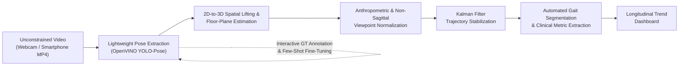

# WalkingLab

**WalkingLab** is a lightweight, semi-automated, vision-based gait tracking, biomechanical quantification, and dataset bootstrapping platform built with **Python**, **OpenVINO**, **Ultralytics YOLO-Pose**, and **NiceGUI (Vue 3)**.

---

## 1. Project Overview

WalkingLab combines high-throughput CPU-accelerated pose estimation with a low-latency web interface to track human movement from standard video streams, curate high-quality ground-truth (GT) pose datasets, fine-tune domain-specific models via few-shot learning, and extract clinical gait metrics.

By decoupling heavy computer vision inference on the Python backend from real-time HTML5 Canvas and interactive SVG rendering on the Vue 3 frontend, WalkingLab achieves responsive video scrubbing, zero-latency keypoint manipulation, and smooth real-time webcam tracking on commodity hardware.

---

## 2. Project Vision

Traditional biomechanical gait assessments require specialized motion-capture laboratories, force plates, or wearable sensor arrays—limiting their accessibility for routine clinical follow-ups or home-based monitoring.

**The long-term vision of WalkingLab** (detailed in [`General_Plan.md`](General_Plan.md)) is to enable **objective, longitudinal assessment of human walking patterns**—tracking rehabilitation progress, post-surgical recovery, or neurological/musculoskeletal regression over weeks and months—directly from unconstrained smartphone or webcam videos (such as casual tripod setups at home).

### Target End-to-End Pipeline


1. **Lightweight Pose Extraction**: Real-time and batched 17-keypoint COCO pose extraction using OpenVINO-accelerated Ultralytics YOLO-Pose models.
2. **2D-to-3D Spatial Localization & Floor-Plane Estimation**: Lifting 2D image keypoints $(x, y)$ into 3D spatial coordinates $(X, Y, Z)$ and estimating the walking floor plane to establish an accurate world reference frame for ground-contact events.
3. **Anthropometric & Non-Sagittal Viewpoint Normalization**: Correcting perspective foreshortening and oblique camera angles using invariant upper-body and facial anchors (e.g., bi-acromial shoulder width, inter-ocular / ear ratios) alongside affine/homography projection.
4. **Kalman Filter Trajectory Stabilization**: State-space filtering ($[p_x, p_y, v_x, v_y]^T$) to eliminate frame-to-frame jitter and self-occlusion spikes (especially during foot crossover) while preserving true rapid deceleration at heel-strike.
5. **Automated Gait Cycle Segmentation & Clinical Metric Extraction**: Detecting heel-strike and toe-off events to segment full gait cycles ($0\text{--}100\%$) and compute spatiotemporal parameters (stride/step length, cadence, stance-to-swing ratio) and kinematic joint angle curves.
6. **Longitudinal Trend Visualization**: Plotting intra-session consistency and multi-session progression over weeks and months to highlight meaningful functional changes.
7. **Interactive Dataset Bootstrapping & Few-Shot Learning**: Curating corrected ground-truth frames across multiple videos and fine-tuning YOLO-Pose weights directly within the application to adapt to challenging home environments, clothing, or assistive devices.

---

## 3. Current State of the Project

For detailed module boundaries and data flows, see [`Architecture.md`](Architecture.md).

### What Is Implemented & Functional Now

* **Decoupled Backend & Client-Side Rendering Architecture (`walkinglab/ui/components/video_tracker.py`, `video_tracker.js`)**:
  * The Python backend serves lightweight normalized JSON coordinate streams (`[0, 1]`) and fine-tuned `.pt` weights rather than heavy server-rendered video frames, immediately deleting uploaded temporary videos once batch inference completes.
  * A custom Vue 3 component (`VideoTracker`) handles HTML5 `<video>` and `<canvas>` playback alongside a zero-latency interactive SVG skeletal overlay.
* **OpenVINO-Accelerated YOLO-Pose Inference (`walkinglab/backend/inference.py`)**:
  * Dual statically-shaped OpenVINO compilation pipelines sharing a single base `ov.Model` (`yolo26s-pose.pt` by default) and unified preprocessor/postprocessor:
    * **Live Webcam Pipeline (`B=1`, `LATENCY`)**: Compiled with static shape `[1, 3, 640, 640]` for minimal single-frame latency.
    * **Offline Video Batch Pipeline (`B=4`, `THROUGHPUT`)**: Compiled lazily with static shape `[4, 3, 640, 640]` and executed asynchronously via `ov.AsyncInferQueue`.
  * Empirical per-frame latency tracking and `/api/estimate` endpoint for accurate batch upload ETA calculation.
  * Lazy model weight switching via the `InferenceConfig.active_weights_path` `@property` (`inference.config.active_weights_path`) that avoids upfront model loading until an inference request is triggered.
* **Real-Time Buffered Webcam Pipeline (`walkinglab/backend/filtering.py`)**:
  * Adaptive **200 ms delayed playback buffer** (`RealtimeFrameBufferInterpolator`) with configurable frame dilation (inferring `1` in `4` frames by default).
  * NumPy linear trajectory interpolation (`interpolate_frame_sequence`) across intermediate frames (`[prev_frame_index .. frame_index]`).
  * Dynamic buffer expansion when backend inference latency exceeds half the active buffer window.
* **Interactive GT Annotation & Few-Shot Learning Workspace (`walkinglab/ui/annotation.py`, `walkinglab/backend/training.py`, `walkinglab/backend/keypoints.py`)**:
  * **17-Keypoint COCO Overlay & Inspector**: Renders all 17 COCO keypoints with distinct categorical hex colors and 16 anatomical bone connections. Supports drag-and-drop and click-to-place editing, per-frame occlusion toggling (`visibility === 0` styled with dashed rings), and per-keypoint visibility filtering.
  * **Multi-Video Browser-Side GT Session**: Captures clean un-annotated base64 video frames (`image_b64`) and refined markers into a persistent 100% client-side session (`sessionSamples`) with an always-visible bottom **Session GT Filmstrip** for reviewing, editing, or deleting saved GT samples across multiple videos.
  * **Browser-Native Session Export & Import (`.zip`)**: Packages (`Save Session (.zip)`) and reloads (`Load Session (.zip)`) sessions directly in the browser as standard Ultralytics YOLO-Pose dataset archives (`session.json`, `annotations.json`, `data.yaml`, `images/train/*.jpg`, and `labels/train/*.txt`), sending the compressed `.zip` to the backend only when few-shot training is requested.
  * **On-Demand Few-Shot Fine-Tuning (`run_few_shot_training`)**: Strictly isolated training worker executed via `run.cpu_bound` with configurable hyperparameters (`Epochs`, `Learning Rate`, `Freeze Layers`), returning fine-tuned `.pt` weights for immediate download (`Save New Weights (.pt)`) or one-click hot-swapping (`Use Trained`).
* **Clinical Pose Assessment Workspace (`walkinglab/ui/pose.py`)**:
  * Live webcam and batch MP4 pose tracker paired with a guided 3-step clinical assessment workflow.
* **Platform Reliability (`walkinglab/__init__.py`)**:
  * Automatic Windows `msvc-runtime` DLL directory registration (`os.add_dll_directory` and `PATH`) ensuring seamless OpenVINO (`_pyopenvino`) and PyTorch (`c10.dll`) initialization when launched via `uv`.

### What Is Currently Stubbed / In Progress

* **Kalman Filter Trajectory Smoothing (`walkinglab/backend/filtering.py`)**:
  * `smooth_trajectory(keypoints_sequence)` is currently a pass-through stub awaiting full constant-velocity state-space Kalman Filter implementation.
* **Automated Gait Cycle Segmentation & Biomechanical Metrics (`walkinglab/backend/analysis.py`)**:
  * `calculate_metrics(smoothed_trajectory)` is currently a placeholder returning stubbed `stride_length` and `cadence` values.
* **Longitudinal Metrics Dashboard UI (`walkinglab/ui/metrics.py`)**:
  * Currently a placeholder tab awaiting kinematic curve plotting and multi-session trend charts.
* **Settings & Hyperparameter Tuning UI (`walkinglab/ui/settings.py`)**:
  * Currently a placeholder tab awaiting interactive controls for camera selection, buffer delay, frame dilation, and Kalman filter parameters.

---

## 4. Quick Onboarding Guide (Installation & Running)

### Prerequisites

* **Operating System**: Windows, Linux, or macOS (Windows 10/11 fully supported with bundled `msvc-runtime`).
* **Python**: `>= 3.13`
* **Package Manager**: [`uv`](https://docs.astral.sh/uv/) (recommended) or standard `venv` + `pip`.
* **Input Source**: A connected webcam for live tracking or `.mp4` walking video files for offline batch analysis and annotation.

### Installation Steps

1. **Clone the repository and navigate to the project root**:
   ```bash
   git clone <repository-url>
   cd WalkLab
   ```

2. **Install dependencies**:

   * **Option A — Using `uv` (Recommended)**:
     ```bash
     uv sync
     ```

   * **Option B — Using standard `venv` + `pip`**:
     ```bash
     python -m venv .venv
     # On Windows (PowerShell):
     .\.venv\Scripts\Activate.ps1
     # On Linux / macOS:
     source .venv/bin/activate

     pip install -e .
     ```

### Model Weights Setup

* By default, WalkingLab uses **`yolo26s-pose.pt`** placed in the project root (`c:\Projects\WalkLab\yolo26s-pose.pt`).
* If not present locally, Ultralytics will automatically resolve/download standard weights on first inference, or you can upload any custom `.pt` YOLO-Pose weights file directly via the **1. Model Weights** card in the **Annotation** tab.

### Running the Application

* **With `uv`**:
  ```bash
  uv run python main.py
  ```
* **With an activated virtual environment**:
  ```bash
  python main.py
  ```

NiceGUI will start the local FastAPI/Uvicorn web server (default: **`http://localhost:8080`**) and automatically open the WalkingLab interface in your default web browser.

### Quick-Start Walkthrough

1. **Annotation & Few-Shot Learning Tab (`Annotation`)**:
   * **Step 1 — Model Weights**: Verify `Default: yolo26s-pose.pt` is active, or click **Upload .pt** to select custom weights.
   * **Step 2 — Load Video or Session**: Click **Load Video** to upload an `.mp4` file (batched OpenVINO inference will run automatically with an ETA progress bar), or click **Load Session (`.zip`)** to restore a previous GT annotation archive directly in the browser.
   * **Step 3 — Refine Keypoints & Build GT Session**: Scrub or step through frames (`Prev (-1)` / `Next (+1)`). Drag any keypoint on the SVG canvas or select a keypoint in the right-hand **17-Keypoint Inspector** to click-to-place or toggle occlusion. Click **Save Current Frame to Session (GT)** (or `+ Save Frame to Session` in the bottom filmstrip) to add the frame to the **Session GT Filmstrip**.
   * **Step 4 — Export or Fine-Tune**: Click **Save Session (`.zip`)** to download a ready-to-train YOLO-Pose dataset archive directly from the browser, or click **Train Few-Shot Model** (optionally adjusting `Epochs`, `LR (lr0)`, and `Freeze Layers` under **Advanced Settings**) to fine-tune weights in the background and download (**Save New Weights (`.pt`)**) or hot-swap them (**Use Trained**).
2. **Pose Estimation Tab (`Pose Estimation`)**:
   * Use the live webcam toggle for buffered real-time skeletal tracking or upload a walking video to inspect extracted pose trajectories alongside the guided clinical workflow.

### Running the Test Suite

Run the automated `pytest` suite to verify keypoint formatting, real-time buffer interpolation, YOLO-Pose `.zip` session packing/unpacking, and few-shot training pipelines:

```bash
uv run pytest
```
*(or `pytest` inside an activated virtual environment).*

---

## 5. Project Structure

```text
WalkLab/
├── main.py                          # Application entry point & FastAPI routes (/api/upload_video, /api/estimate)
├── pyproject.toml                   # Project metadata, Python >=3.13 requirement, and dependencies
├── General_Plan.md                  # Master system vision, architectural goals, and module specifications
├── Architecture.md                  # Living architecture documentation, module responsibilities, and data flows
├── README.md                        # Project overview, onboarding guide, and engineering roadmap
├── yolo26s-pose.pt                  # Default pre-trained Ultralytics YOLO-Pose weights
├── walkinglab/                      # Core Python package
│   ├── __init__.py                  # Platform initialization (Windows msvc-runtime DLL registration)
│   ├── backend/                     # Decoupled computer vision, training, filtering, and analysis engine
│   │   ├── inference.py             # OpenVINO dual-pipeline (LATENCY B=1 / THROUGHPUT B=4) YOLO-Pose engine
│   │   ├── keypoints.py             # 17 COCO keypoint definitions, colors, skeleton edges, & YOLO dataset builders
│   │   ├── training.py              # Isolated .zip session packer/unpacker & background few-shot YOLO trainer
│   │   ├── filtering.py             # Real-time frame buffer interpolator & Kalman filter stub
│   │   └── analysis.py              # Biomechanical gait metric extraction stub
│   └── ui/                          # NiceGUI & Vue 3 frontend layer
│       ├── app.py                   # Main NiceGUI page layout and tab router
│       ├── annotation.py            # Unified GT Annotation Session & Few-Shot Learning workspace
│       ├── pose.py                  # Clinical Pose Assessment & live/batch visualization workspace
│       ├── metrics.py               # Longitudinal trend & kinematic curve dashboard (stub)
│       ├── settings.py              # Camera, buffer, & filter hyperparameter controls (stub)
│       └── components/              # Custom Vue 3 / HTML5 Canvas / SVG components
│           ├── video_tracker.py     # Python wrapper for the VideoTracker NiceGUI component
│           └── video_tracker.js     # Client-side video player, 200ms webcam buffer, SVG editor, & GT filmstrip
└── tests/                           # Automated pytest verification suite
    ├── test_annotation.py           # Tests for COCO keypoints, session .zip roundtrips, and few-shot training
    ├── test_buffer_interpolation.py # Tests for frame dilation, linear interpolation, and buffer adaptation
    ├── test_inference.py            # Tests for OpenVINO dual-pipeline YOLO-Pose inference and weights management
    ├── test_readme.py               # Automated checks for README completeness, onboarding, and roadmap
    └── test_scaffolding.py          # Tests for module structure and baseline scaffolding
```

---

## 6. Roadmap & To-Do List

The following research and engineering milestones are planned to complete the end-to-end clinical gait analysis vision:

- [ ] **1. Research and implement 2D-to-3D locations in space**:
  - Lift 2D normalized image keypoints $(x, y)$ into 3D spatial coordinates $(X, Y, Z)$, addressing monocular depth ambiguity, perspective foreshortening, and non-sagittal camera viewing angles.
- [ ] **2. Research common metrics and practices used for gait evaluation**:
  - Survey clinical gait analysis standards and implement core spatiotemporal parameters (stride length, step length, cadence, gait velocity, stance-to-swing phase ratio, double-support time, step width, and gait symmetry indices) and kinematic joint angle trajectories (hip, knee, and ankle flexion/extension curves normalized across $0\text{--}100\%$ of the gait cycle) in `walkinglab/backend/analysis.py`.
- [ ] **3. Research how to get floor plane estimation for the walking patterns**:
  - Develop monocular ground/floor plane estimation (e.g., via foot-contact point clouds, homography estimation, vanishing points, or monocular depth/surface normal estimation) to establish a world reference frame, accurately detect heel-strike and toe-off ground contact events, and measure true step trajectories along the walking surface.
- [ ] **4. Usability research**:
  - Conduct user experience (UX) studies and workflow evaluations with target personas (clinicians, physical therapists, biomechanics researchers, and patients recording at home) to streamline camera setup guidance, annotation speed, guided assessment steps, and clinical report interpretability.
- [ ] **5. Implement Kalman Filter Trajectory Smoothing (`walkinglab/backend/filtering.py`)**:
  - Complete the constant-velocity state-space Kalman Filter ($[p_x, p_y, v_x, v_y]^T$) in `smooth_trajectory` with tuned process ($Q$) and measurement ($R$) noise covariance matrices to suppress self-occlusion spikes while preserving rapid heel-strike deceleration dynamics.
- [ ] **6. Anthropometric & Non-Sagittal Viewpoint Normalization**:
  - Implement invariant upper-body and facial anchor scaling (e.g., bi-acromial shoulder width, inter-ocular and nose-to-ear ratios) and affine/homography transformations to normalize spatial measurements across varying camera distances and oblique angles.
- [ ] **7. Automated Gait Cycle Segmentation**:
  - Automatically detect heel-strike to heel-strike cycles and stance/swing phase transitions from smoothed ankle/heel trajectories and floor-plane contact events.
- [ ] **8. Complete the Longitudinal Metrics Dashboard (`walkinglab/ui/metrics.py`)**:
  - Build interactive charts for within-session kinematic curves ($0\text{--}100\%$ gait cycle) and multi-session longitudinal trend tracking (highlighting variance, recovery progression, or regression over weeks/months).
- [ ] **9. Complete the Settings & Hyperparameter Tuning Panel (`walkinglab/ui/settings.py`)**:
  - Expose interactive UI controls for camera device selection, real-time buffer delay (`bufferDelayMs`), inference frame dilation (`frameDilation`), and Kalman filter hyperparameters ($Q$, $R$).
